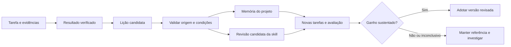

# Roadmap de evolução das skills: especialização, investigação e aprendizado

Data: 15/10/2026. Status: proposta para execução, fundamentada em inspeção local e
pesquisa de fontes primárias. Escopo: as **305 skills** presentes no repositório.

**Recomendação:** evoluir o catálogo como um sistema de conhecimento com pesquisa,
avaliação e manutenção contínuas. Cada skill deve ajudar o agente a tomar decisões
melhores, reconhecer lacunas, investigar hipóteses e revisar conclusões. A experiência
de uso deve gerar melhorias candidatas cuja utilidade seja verificada antes da adoção.

Este documento entrega o plano. Foram inventariados todos os pacotes, inspecionados
o processo de revisão, a arquitetura, o gerador de auditoria e exemplos de skills e
relatórios. A pesquisa cobre os mecanismos de evolução e fontes de entrada para as
15 famílias técnicas. **Não foi realizada uma nova revisão técnica completa de cada
uma das 305 skills, nem um experimento que comprove melhoria neste trabalho.** Essa
revisão individual faz parte das etapas abaixo.

O [inventário de cobertura](skills-evolution-inventory.md) relaciona cada skill,
versão, família e onda proposta. Este roadmap desenvolve a proposta anterior de
[otimização de agentes e skills](agent-harness-optimization-plan.md), preservada.

## 1. Diagnóstico do ponto de partida

| Constatação                                                                                                                                                                 | Evidência local                                                                                                                     | Consequência para o plano                                                                                                                    |
| --------------------------------------------------------------------------------------------------------------------------------------------------------------------------- | ----------------------------------------------------------------------------------------------------------------------------------- | -------------------------------------------------------------------------------------------------------------------------------------------- |
| Há 305 diretórios com `skill.yaml` e `SKILL.md`; o dicionário contém 258 entradas individuais.                                                                              | `skills/*`, [SKILLS.md](../SKILLS.md), [sincronizador](../scripts/sync-skills-dictionary-versions.mjs).                             | Atualizar cobertura e taxonomia; sincronizar apenas versões não inclui as 47 entradas ausentes.                                              |
| O processo já exige investigação, compatibilidade, fontes primárias e avaliação proporcional.                                                                               | [Prompt de revisão](skill-review-prompt.md), [skill-engineering](../skills/skill-engineering/SKILL.md).                             | Reutilizar o processo e melhorar sua execução e rastreabilidade.                                                                             |
| O catálogo já contém investigação por hipóteses e colaboração iterativa.                                                                                                    | [debugging](../skills/debugging/SKILL.md), [collaborative-feature-definition](../skills/collaborative-feature-definition/SKILL.md). | Reaproveitar esses comportamentos onde forem pertinentes, evitando duplicá-los em todas as skills.                                           |
| Há avaliações comportamentais registradas, com limites explícitos.                                                                                                          | [Registro de microserviços](skill-validation/microservices-architecture-2026-09-30.md).                                             | Preservar casos, resultados e limitações; não tratar o catálogo como se nunca tivesse sido avaliado.                                         |
| As notas históricas não constituem uma medição do efeito das skills.                                                                                                        | `scoreAfter` e `scoreBefore` em [build-audit-reports.mjs](../scripts/build-audit-reports.mjs); [scorecards](audit/SKILL-SCORES.md). | Separar indicadores estruturais, pareceres técnicos e desempenho observado. Não usar “9,4/10 Expert” como evidência de ganho comportamental. |
| O produto implementado é um gerenciador de pacotes; não foi localizado um executor integrado de experimentos ou serviço de memória nas portas, scripts e CLI inspecionados. | [Arquitetura](../ARCHITECTURE.md), [design](../DESIGN.md), [portas](../packages/core/src/ports/), [package.json](../package.json).  | Começar com um piloto reproduzível; decidir a integração de execução e memória por uma proposta arquitetural específica.                     |

O gerador de notas usa bases numéricas por categoria, presença de palavras, quantidade
de referências e tamanho do diff para construir o antes/depois. Isso não invalida
correções técnicas anteriores, mas impede interpretar a diferença de notas como um
experimento. Corrigir essa interpretação é a primeira tarefa de governança.

## 2. O comportamento de especialista que queremos

“Doutor no assunto” deve corresponder a comportamentos verificáveis:

1. **Delimitar o problema:** identificar resultado esperado, restrições, ambiente e
   responsável por cada decisão. Distinguir diagnóstico, proposta e implementação.
2. **Inspecionar antes de perguntar:** consultar código, contratos, configurações,
   versões, testes e decisões já aceitas. Reutilizar evidências suficientes.
3. **Distinguir conhecimento de suposição:** separar observação, inferência,
   hipótese e recomendação quando isso afeta a conclusão.
4. **Questionar premissas relevantes:** explicar qual evidência falta e o que muda
   entre respostas possíveis. Não transformar tarefas simples em entrevistas.
5. **Considerar alternativas reais:** identificar condições em que a recomendação
   deixa de valer, inclusive a possibilidade de manter a solução existente.
6. **Buscar evidência discriminante:** escolher uma leitura, prova de contrato,
   reprodução ou experimento que diferencie explicações concorrentes.
7. **Atualizar o entendimento:** quando uma evidência contradisser a hipótese,
   registrar o que mudou e revisar apenas as decisões afetadas.
8. **Verificar o resultado:** usar testes, artefatos, contratos e medições adequados
   à afirmação; declarar o que permaneceu desconhecido.
9. **Extrair uma lição com condições de aplicação:** uma solução local não se torna
   automaticamente regra universal ou preferência permanente do usuário.

Regra proposta para perguntas: perguntar quando a lacuna muda materialmente a
decisão e não pode ser resolvida pelas evidências acessíveis. Fazer uma pergunta
quando ela determina o próximo passo; agrupar duas ou três quando forem
independentes. Continuar o trabalho autorizado que não depende da resposta.

Exemplo de evolução do entendimento: diante de “aumente o pool para resolver a
latência”, inspecionar espera por conexão e capacidade do banco. Se a nova evidência
mostrar bloqueio no banco, revisar a hipótese e a recomendação. A lição preservada
deve registrar essa condição; não virar “nunca aumente pools”. É um cenário proposto,
não uma conclusão sobre qualquer serviço real.

## 3. Práticas públicas que fundamentam a proposta

As fontes abaixo mostram práticas publicadas por fornecedores e pesquisadores.
Não existe aqui uma alegação de conhecer todos os processos internos das empresas
ou de haver uma certificação universal de qualidade de skills.

| Base pesquisada                                                                                                                                                                                                                      | Prática observada                                                                                   | Aplicação proposta                                                                               |
| ------------------------------------------------------------------------------------------------------------------------------------------------------------------------------------------------------------------------------------ | --------------------------------------------------------------------------------------------------- | ------------------------------------------------------------------------------------------------ |
| [Agent Skills: autoria](https://agentskills.io/skill-creation/best-practices) e [avaliação](https://agentskills.io/skill-creation/evaluating-skills)                                                                                 | Especialização baseada em conhecimento concreto e avaliação do resultado.                           | Instruções com critérios de decisão, limites e casos próprios do domínio.                        |
| [Anthropic: Agent Skills](https://www.anthropic.com/engineering/equipping-agents-for-the-real-world-with-agent-skills) e [engenharia de contexto](https://www.anthropic.com/engineering/effective-context-engineering-for-ai-agents) | Conhecimento modular e carregamento de contexto conforme a necessidade.                             | Corpo enxuto, referências condicionais e medição do contexto efetivamente carregado.             |
| [Anthropic: avaliações de agentes](https://www.anthropic.com/engineering/demystifying-evals-for-ai-agents)                                                                                                                           | Avaliar resultados e trajetórias, combinar avaliadores e considerar variabilidade.                  | Distinguir capacidade, regressão e consistência; examinar os artefatos produzidos.               |
| [OpenAI: boas práticas de avaliação](https://developers.openai.com/api/docs/guides/evaluation-best-practices)                                                                                                                        | Critérios específicos da tarefa, avaliação contínua e calibração humana.                            | Definir sucesso antes do experimento e transformar falhas de uso em casos de teste.              |
| [Google ADK: memória](https://adk.dev/sessions/memory/) e [critérios de avaliação](https://github.com/google/adk-docs/blob/main/docs/evaluate/criteria.md)                                                                           | Memória requer armazenamento e recuperação; resultado e uso de ferramentas são dimensões distintas. | Projetar persistência explicitamente e observar decisões além da resposta final.                 |
| [Microsoft: STATE-Bench](https://opensource.microsoft.com/blog/2026/05/19/introducing-state-bench-a-benchmark-for-ai-agent-memory/)                                                                                                  | Testar se a experiência melhora tarefas, além de verificar recuperação de fatos.                    | Comparar execução com e sem memória em tarefas novas e medir consistência e custo.               |
| [Reflexion](https://arxiv.org/abs/2303.11366)                                                                                                                                                                                        | Feedback textual e memória de experiências podem orientar tentativas seguintes sem atualizar pesos. | Testar lições condicionais; não assumir que resultados daquele estudo se transferem ao catálogo. |
| [Estudo sobre limites de autocorreção](https://arxiv.org/abs/2310.01798) e [estudo de verificação de condições](https://arxiv.org/abs/2405.14092)                                                                                    | Resultados dependem do método, tarefa e modelo; reflexão sozinha não garante melhora.               | Apoiar correções em evidências externas e comparar métodos nos agentes usados pelo projeto.      |
| [Microsoft: envenenamento de memória](https://www.microsoft.com/en-us/security/blog/2026/02/10/ai-recommendation-poisoning/)                                                                                                         | Conteúdo externo pode tentar persistir instruções indevidas.                                        | Tratar memórias recuperadas como dados com origem e escopo, sujeitos a validação.                |

Essas referências fundamentam a direção. Os prazos, pilotos, critérios de promoção e
organização abaixo são propostas específicas para este repositório.

## 4. Pesquisa técnica por família e, depois, por skill

Preservar as categorias A–M existentes e acrescentar N e O para organizar as adições
de Spring e DDD. A classificação é uma proposta de planejamento; ainda não altera
o dicionário oficial. Cada skill aparece exatamente uma vez no inventário.

| Família e quantidade                         | Fontes primárias de entrada consultadas                                                                                                                                                                                                                                                                                                        | Pergunta técnica e evidência a desenvolver na revisão                                                                                       |
| -------------------------------------------- | ---------------------------------------------------------------------------------------------------------------------------------------------------------------------------------------------------------------------------------------------------------------------------------------------------------------------------------------------- | ------------------------------------------------------------------------------------------------------------------------------------------- |
| A — Memória e GC: 19                         | [Guia de GC do Java 25](https://docs.oracle.com/en/java/javase/25/gctuning/introduction-garbage-collection-tuning.html), [especificações Java](https://docs.oracle.com/javase/specs/).                                                                                                                                                         | Distinguir alocação, retenção, pausas e memória nativa; usar capturas identificadas por workload e build.                                   |
| B — Execução e compilação: 18                | [JVMS por versão](https://docs.oracle.com/javase/specs/), [opções do Java 25](https://docs.oracle.com/en/java/javase/25/docs/specs/man/java.html), [GraalVM Native Image](https://www.graalvm.org/latest/reference-manual/native-image/).                                                                                                      | Separar contrato da JVM e comportamento do compilador; localizar implementação e flags da versão antes de recomendar mudanças.              |
| C — Medição, profiling e observabilidade: 33 | [JMH](https://github.com/openjdk/jmh), [OpenTelemetry](https://opentelemetry.io/docs/specs/), [Google SRE Workbook](https://sre.google/workbook/table-of-contents/).                                                                                                                                                                           | Identificar viés de medição, custo de instrumentação e limites de inferência; comparar cargas e janelas equivalentes.                       |
| D — Concorrência: 23                         | [JLS](https://docs.oracle.com/javase/specs/), [jcstress](https://github.com/openjdk/jcstress).                                                                                                                                                                                                                                                 | Demonstrar publicação, atomicidade e ciclo de vida; classificar resultados permitidos/proibidos antes de executar testes.                   |
| E — Plataforma e hardware: 12                | [cgroup v2](https://docs.kernel.org/admin-guide/cgroup-v2.html), [ciclo de vida de Pods](https://kubernetes.io/docs/concepts/workloads/pods/pod-lifecycle/).                                                                                                                                                                                   | Relacionar limites, topologia e encerramento à versão e configuração; observar o sistema relevante, não somente a aplicação.                |
| F — Sistemas distribuídos: 45                | [Design do Kafka 4.1](https://kafka.apache.org/41/design/design/), [AWS: timeouts e retries](https://aws.amazon.com/builders-library/timeouts-retries-and-backoff-with-jitter/).                                                                                                                                                               | Explicitar o limite de cada garantia, falha parcial, duplicação e recuperação; construir histórias de falha e verificadores de invariantes. |
| G — Linguagem e contratos Java: 33           | [JLS e JVMS](https://docs.oracle.com/javase/specs/).                                                                                                                                                                                                                                                                                           | Verificar contratos, compatibilidade e recursos; compilar exemplos na baseline apropriada e testar o comportamento relevante.               |
| H — Padrões GoF: 28                          | [Obra original e catálogo editorial](https://www.informit.com/store/design-patterns-elements-of-reusable-object-oriented-9780201633610), [contratos Java](https://docs.oracle.com/javase/specs/).                                                                                                                                              | Identificar a pressão de mudança que justifica o padrão; comparar com uma solução simples e um caso em que o padrão prejudica.              |
| I — Arquitetura de aplicações: 21            | [Catálogo PoEAA do autor](https://martinfowler.com/eaaCatalog/), [arquitetura hexagonal do autor](https://alistair.cockburn.us/hexagonal-architecture).                                                                                                                                                                                        | Preservar responsabilidades, transações e contratos durante mudanças; avaliar um fluxo real e seus caminhos de falha.                       |
| J — Governança e evolução arquitetural: 11   | [ATAM, CMU/SEI](https://insights.sei.cmu.edu/library/the-architecture-tradeoff-analysis-method-2/).                                                                                                                                                                                                                                            | Explicitar atributos de qualidade, alternativas e conflitos; verificar decisões com cenários observáveis e critérios de revisão.            |
| K — Testes: 6                                | [JUnit](https://docs.junit.org/current/user-guide/), [jcstress](https://github.com/openjdk/jcstress), [testes Spring Boot](https://docs.spring.io/spring-boot/reference/testing/index.html).                                                                                                                                                   | Escolher nível e oráculo que detectem o defeito; demonstrar que o teste falha no caso incorreto e preserva casos válidos.                   |
| L — Processo e entrega: 25                   | [Google: revisão de código](https://google.github.io/eng-practices/review/reviewer/), [Agent Skills](https://agentskills.io/skill-creation/best-practices).                                                                                                                                                                                    | Verificar escopo, perguntas úteis, aceitação e evidência de conclusão em conversas com mudanças de contexto.                                |
| M — Dados e performance: 12                  | [PostgreSQL EXPLAIN](https://www.postgresql.org/docs/current/using-explain.html), [InnoDB 8.4](https://dev.mysql.com/doc/refman/8.4/en/innodb-transaction-model.html), [SQL Server Query Store](https://learn.microsoft.com/en-us/sql/relational-databases/performance/monitoring-performance-by-using-the-query-store?view=sql-server-ver17). | Investigar planos, isolamento, bloqueios, migração e recuperação com dados representativos e o motor correto.                               |
| N — Spring: 10                               | [Spring: transações](https://docs.spring.io/spring-framework/reference/data-access/transaction/declarative/annotations.html), [Spring Boot: testes](https://docs.spring.io/spring-boot/reference/testing/index.html).                                                                                                                          | Conferir interceptação, configuração efetiva, integração e falhas; testar wiring real quando uma unidade isolada não reproduz o contrato.   |
| O — DDD: 9                                   | [DDD Reference, Eric Evans](https://www.domainlanguage.com/ddd/reference/), [PoEAA](https://martinfowler.com/eaaCatalog/).                                                                                                                                                                                                                     | Verificar linguagem, invariantes, fronteiras e autoridade com exemplos do negócio, concorrência e mudanças de requisitos.                   |

Essas são portas de entrada, não bibliografias suficientes para cada pacote. Na
revisão individual, adicionar documentação específica de APIs, drivers, profilers,
protocolos e implementação. Por exemplo, as fontes de E não bastam para confirmar
regras de gRPC, nem as de C bastam para inferência de ML na JVM. A página editorial
de GoF confirma a referência bibliográfica; não substitui a consulta autorizada ao
conteúdo técnico da obra.

URLs com `current` ou `latest` servem à descoberta. Registrar a versão efetivamente
consultada e usar a documentação correspondente ao ambiente de aplicação. O índice
de JEPs e uma árvore versionada do HotSpot não foram recuperados nesta pesquisa;
claims que dependam deles continuam pendentes até a consulta individual. Não há
autorização implícita para atualizar Java ou frameworks dos projetos consumidores.

Para **cada skill**, produzir um pequeno dossiê, aproveitando os existentes:

- Decisões especializadas que ela promete melhorar, escopo e skill vizinha.
- Afirmações relevantes: fonte, seção, data de consulta, versão e condições.
- Pontos de discordância, exceções, limites do conhecimento e o que resolveria a dúvida.
- Casos representativos, contraexemplos e evidência apropriada a cada afirmação.
- Correções justificadas, resultado da validação e pendências identificadas.

Dar prioridade a alegações com alto impacto, dependência de versão, falhas observadas
ou evidência insuficiente. Uma fonte normativa adequada pode resolver um contrato;
acumular links que repetem a mesma informação não aumenta automaticamente a certeza.

## 5. Como aprender com o tempo

Uma skill em Markdown pode orientar o uso de feedback. Persistência entre sessões,
recuperação e atualização confiáveis dependem de ferramentas e de um processo que
as execute. Acrescentar “aprenda continuamente” ao texto não implementa esse sistema.

| Camada                 | Conteúdo                                                           | Como evolui                                                                                                |
| ---------------------- | ------------------------------------------------------------------ | ---------------------------------------------------------------------------------------------------------- |
| Entendimento da tarefa | Fatos, hipóteses, perguntas abertas e decisões da execução atual.  | Atualiza-se com respostas, arquivos e resultados de ferramentas; não precisa se tornar memória permanente. |
| Memória do projeto     | Contratos e decisões locais validados, com escopo e validade.      | Persistência explícita, recuperação seletiva e invalidação quando versões ou decisões mudarem.             |
| Experiências           | Problema, tentativa, evidência do resultado e lição condicionada.  | Entram como candidatas; são verificadas antes de orientar trabalho futuro.                                 |
| Conhecimento da skill  | Procedimento reutilizável e independente de um projeto particular. | Mudança de conteúdo revisada, avaliada e versionada pelo fluxo do repositório.                             |

Atualizar pesos do modelo é outro processo. Fine-tuning não é pré-requisito deste
roadmap; só merece estudo posterior se avaliações mostrarem uma limitação que as
camadas acima não resolvem de forma adequada.

Contrato mínimo proposto para uma lição: identificador, tipo, projeto/escopo,
afirmação, condições de aplicação, origem e versão da evidência, resultado da
verificação, estado de revisão, data de revalidação e relação com o item substituído.
Guardar referências a evidências suficientes, evitando copiar conversas completas
ou dados sensíveis por padrão.

Regras de aprendizado:

- Separar fato do projeto, preferência explícita do usuário e hipótese do agente.
- Evidência atual e pertinente pode invalidar memória antiga. Recência isolada
  não estabelece autoridade; tratar contradições de forma explícita.
- Recuperar apenas itens relevantes ao problema, compatíveis com versão e escopo.
  Aplicar orçamento de contexto e medir utilidade da recuperação.
- Manter estados como candidato, validado, substituído e invalidado. Permitir
  correção e exclusão, sem continuar usando cópias antigas no índice de recuperação.
- Conteúdo de páginas, logs e memórias não concede permissões nem redefine a tarefa.
  Cobrir instruções maliciosas, mistura entre projetos e memórias incorretas nos testes.
- Uma mudança geral exige abstração e validação em contextos independentes;
  um fato específico pode permanecer somente na memória do projeto.
- Começar com artefatos locais pequenos e inspecionáveis. Adotar busca vetorial ou
  serviço externo apenas se a necessidade de recuperação e a avaliação justificarem.

O ciclo pode coletar evidências e propor mudanças dentro da autorização concedida.
Publicação, instalação global e alterações reais de configuração continuam seguindo
as regras do repositório e a autorização do usuário. Evitar pedidos de confirmação
para cada anotação ou decisão rotineira já autorizada.

## 6. Como demonstrar que uma revisão melhorou a skill

O objeto avaliado é a combinação **agente, modelo, skill, contexto, ferramentas
e ambiente**. Registrar revisão do repositório, hash e versão das skills e dependências,
versões disponíveis do modelo/runtime, configurações, ferramentas, limites e entradas.

Comparar três condições, mantendo o restante equivalente:

- **A:** tarefa sem a skill alvo, com o contexto comum documentado.
- **B:** mesma tarefa com a versão de referência.
- **C:** mesma tarefa com a candidata.

As dependências e skills vizinhas precisam ter tratamento registrado: uma ablação da
skill alvo mantendo companheiras responde a uma pergunta diferente da remoção de
toda a família. Não permitir que o caso A leia indiretamente a skill removida.

Avaliar ativação separadamente: disponibilizar o catálogo ao runtime, enviar pedidos
naturais e observar seleção, não seleção e encaminhamento. Carregar explicitamente
a skill mede execução, mas não comprova descoberta automática. Se o runtime não
expuser ativação, reportar a lacuna.

Para memória, fixar a versão da skill e comparar memória desligada, memória validada
e memória obsoleta/conflitante. Usar uma sequência temporal: aprender em tarefas
anteriores, congelar o estado e testar transferência em tarefas novas. Não fornecer
à memória respostas esperadas dos testes reservados.

Conjunto inicial proposto por piloto: **12 tarefas, sendo 8 de desenvolvimento e 4
reservadas**, com três repetições por condição e um runtime. Isso representa
`12 × 3 condições × 3 repetições = 108 execuções`, antes de avaliações específicas
de ativação e memória. É um desenho inicial para detectar problemas e estimar
variabilidade; não constitui, por si só, uma amostra suficiente para qualquer
percentual de ganho. Executar o segundo runtime depois de estabilizar o piloto.

Incluir conforme o risco: tarefa comum, não ativação, informação ausente, mudança de
restrição, pressão por solução incorreta, ferramenta indisponível, nova evidência
que refuta uma hipótese e caso adversarial. Um par de casos deve trocar uma condição
decisiva e verificar se a recomendação muda corretamente.

Separar entradas do agente e material exclusivo do avaliador. Sessão nova não isola
filesystem, caches ou ferramentas: usar snapshots e controles de acesso adequados,
resetar estado e declarar limitações. Expectativas e resultados anteriores não podem
ficar visíveis ao agente. Reservar casos por problema/projeto, evitando paráfrases
da mesma solução nos conjuntos de desenvolvimento e avaliação.

| Medida                  | Evidência e interpretação                                                                                                     |
| ----------------------- | ----------------------------------------------------------------------------------------------------------------------------- |
| Sucesso verificável     | Contratos atendidos, testes adequados e artefato final inspecionado; contabilizar falhas e execuções inválidas separadamente. |
| Erros graves            | Violações de invariantes, segurança, escopo ou informação fabricada; preservar o caso concreto.                               |
| Qualidade das perguntas | Perguntas necessárias, perguntas redundantes e suposições indevidas diante de lacunas.                                        |
| Revisão de entendimento | Correção da decisão após informação contraditória, sem perder restrições já válidas.                                          |
| Ativação                | Acertos e falsos positivos/negativos por skill e por família, onde houver observabilidade.                                    |
| Memória                 | Utilidade em novas tarefas, rejeição de informação inválida, isolamento e recorrência de erros conhecidos.                    |
| Consistência            | Distribuição de resultados por tarefa e repetição; não selecionar apenas a melhor tentativa.                                  |
| Eficiência              | Custo por tarefa resolvida, incluindo falhas, tokens, tempo até resultado válido e intervenções humanas.                      |

Preferir verificadores determinísticos quando representam o contrato. Usar revisão
de especialista para decisões abertas e calibrar avaliadores de modelo com casos
humanamente revisados. O agente que produziu a alteração não deve ser a única
autoridade para declarar seu ganho. Avaliadores diferentes podem compartilhar vieses.

Critério proposto de promoção: integração válida, correção sustentada por evidência,
nenhuma regressão grave observada nos casos definidos e benefício compatível com o
custo. Fixar tolerâncias e benefício mínimo relevante antes da comparação, após
medir a baseline; não inventar uma meta universal de “95% de qualidade”. Amostras
pequenas ou resultados inconclusivos devem ser apresentados como tais. Repetições
da mesma tarefa não equivalem a problemas independentes.

Correções de um erro técnico demonstrável podem ser necessárias mesmo sem ganho
estatisticamente detectável. Nesse caso, registrar a correção e o limite da avaliação,
sem anunciar melhoria comportamental comprovada. Preservar o resultado negativo de
uma candidata que ficou pior ou não acrescentou valor.

## 7. Etapas de entrega

Horizonte inicial proposto: **90 dias para consolidar o processo, os pilotos e uma
primeira expansão**. Estimativa de planejamento, não compromisso de revisão integral
das 305 skills nesse período. Pressupõe um mantenedor responsável, disponibilidade
de especialistas para decisões relevantes e orçamento de execução definido.

| Etapa                               | Janela indicativa e dependência     | Entrega concreta                                                                                                              | Condição de saída                                                                                       |
| ----------------------------------- | ----------------------------------- | ----------------------------------------------------------------------------------------------------------------------------- | ------------------------------------------------------------------------------------------------------- |
| 0 — Baseline confiável              | Dias 1–7                            | Inventário atualizado, mapa de evidências existentes, correção da interpretação de scorecards, fila por risco e responsáveis. | As 305 skills têm destino; resultados históricos distinguem análise, testes e avaliação comportamental. |
| 1 — Contrato de especialização      | Dias 8–14, após 0                   | Ajustes necessários no processo e em `skill-engineering`, exemplos de investigação e contrato de lições.                      | Revisão isolada da referência concluída; casos e critérios do primeiro piloto congelados.               |
| 2 — Primeiro experimento            | Dias 15–28, após 1                  | Piloto `debugging`, comparação A/B/C, relatório com custos, falhas e limites de isolamento.                                   | Experimento reproduzível; decisão fundamentada de adotar, revisar ou rejeitar a candidata.              |
| 3 — Profundidade em outros domínios | Dias 29–45, após 2                  | Pilotos de concorrência, Spring e dados; completar os demais conforme custo observado.                                        | Método funciona com diferentes tipos de evidência e não depende apenas de julgamento textual.           |
| 4 — Memória e aprendizado           | Dias 46–60, após baseline estável   | Memória local mínima e comparação temporal com memória ausente, correta e conflitante.                                        | Utilidade e limites documentados; invalidação, exclusão e isolamento exercitados.                       |
| 5 — Expansão por ondas              | Dias 61–90, após critérios estáveis | Lotes priorizados, avaliação de composição e repetição dos pilotos no segundo agente.                                         | Capacidade de revisão medida, regressões controladas e próximas ondas estimadas com dados reais.        |
| 6 — Operação contínua               | Depois do primeiro ciclo            | Revisões por incidentes e mudanças de fontes, manutenção dos testes e descontinuação justificada.                             | Cada alteração relevante tem origem, avaliação proporcional e registro de versão.                       |

Pilotos propostos, nessa ordem inicial:

| Skill                             | Motivo e principal caso a construir                                                                                           |
| --------------------------------- | ----------------------------------------------------------------------------------------------------------------------------- |
| `debugging`                       | Investigar uma causa concorrente e corrigir a hipótese após nova evidência; primeiro piloto de baixo custo de infraestrutura. |
| `java-memory-model`               | Distinguir prova de contrato e ausência de falhas em testes; rejeitar correção que apenas altera timing.                      |
| `spring-transactions-and-events`  | Confirmar semântica de interceptação e recuperação em um cenário de integração controlado.                                    |
| `sql-query-performance`           | Recusar índice ou tuning universal; decidir com plano, distribuição de dados e restrições do motor.                           |
| `retries-and-backoff`             | Preservar orçamento e semântica diante de timeout com resultado desconhecido.                                                 |
| `architecture-trade-off-analysis` | Rever a escolha quando uma restrição arquitetural muda, justificando o conflito entre alternativas.                           |

`skill-engineering` é a referência de autoria, processada isoladamente antes dos
pilotos. Não a alterar enquanto revisores a usam. As ondas do inventário organizam
o restante; dependências de implantação do processo prevalecem sobre a ordem dos
nomes. Incidente comprovado pode elevar a prioridade de qualquer skill.

Estimar a expansão pela capacidade efetiva de concluir pesquisa, revisão e
avaliação, não pelo número de agentes abertos. Exemplo de capacidade, **não previsão**:
após seis pilotos e a referência, restam 298 skills; a 10 conclusões por semana,
seriam aproximadamente 30 semanas. Recalcular após dois lotes; algumas skills podem
ser mantidas sem mudança quando a revisão não encontrar defeitos.

## 8. Backlog inicial e responsabilidades

| Item                                      | Responsável funcional                    | Aceitação                                                                                              |
| ----------------------------------------- | ---------------------------------------- | ------------------------------------------------------------------------------------------------------ |
| R01 — Atualizar dicionário e cobertura    | Mantenedor do catálogo                   | Conjunto do dicionário coincide com manifests; categorias e versões coerentes.                         |
| R02 — Corrigir uso de notas históricas    | Mantenedor de qualidade                  | Heurística estrutural rotulada como tal; nenhuma alegação de ganho derivada de volume de diff.         |
| R03 — Consolidar evidências já existentes | Responsável por avaliação                | Casos escritos, execuções, testes de exemplos e comparações identificados separadamente.               |
| R04 — Definir primeiro piloto             | Especialista + responsável por avaliação | Inputs, falhas, verificadores, conjunto reservado e limites de execução definidos antes da candidata.  |
| R05 — Executar comparação mínima          | Responsável por avaliação                | Resultados A/B/C, hashes, condições, custos e limitações reprodutíveis.                                |
| R06 — Validar o ciclo de memória          | Responsável pelo runtime + especialista  | Recuperação útil, correção, invalidação, exclusão e rejeição de memória hostil demonstradas nos casos. |
| R07 — Revisar lotes por domínio           | Revisores `skill-reviewer` + coordenador | Um proprietário por skill; mudanças e evidências integradas sem conflitos.                             |
| R08 — Manter qualidade ao longo do tempo  | Mantenedor + responsáveis de domínio     | Gatilhos de revisão e histórico de incidentes, decisões e releases em funcionamento.                   |

São responsabilidades, não exigência de oito pessoas. Uma equipe pequena pode
acumular funções; manter ao menos a revisão independente das decisões mais relevantes.

Ao executar revisões de várias skills, seguir o
[workflow paralelo](parallel-skill-reviews.md): um `skill-reviewer` por skill,
leitura do [prompt completo](skill-review-prompt.md), propriedade exclusiva dos
arquivos e paralelismo limitado pela capacidade real do ambiente e de integração.
Somente o coordenador regenera o índice e executa a verificação global, depois de
todos os revisores terem parado de escrever. Delegação acelera pesquisa; não
substitui independência de evidência nem isolamento de experimentos.

## 9. Integração técnica e preservação da arquitetura

Primeiro reutilizar `docs/skill-validation/` e as ferramentas já disponíveis para
um piloto isolado. Não criar um framework inteiro antes de comprovar a necessidade.
Um executor recorrente ou memória persistente integrados ao produto exigem decisão
arquitetural conforme [ARCHITECTURE.md](../ARCHITECTURE.md) e [DESIGN.md](../DESIGN.md).

Direção proposta, ainda sem novos contratos implementados:

- Manter `AgentAdapter` com detecção, descrição e projeção. Execução, se integrada,
  deve ter porta própria e capacidades verificadas por runtime.
- Manter política e contratos sem I/O no `core`; processos, filesystem e rede em
  `node`; convenções de agentes em `adapter-*`; composição em `cli`.
- Preparar instalações experimentais pelo fluxo existente. `AtomicInstaller`
  continua sendo o único escritor nos diretórios de skills dos agentes.
- Guardar memória e resultados fora dos pacotes instalados. Não alterar em uso
  uma skill publicada nem incluir material exclusivo do avaliador no pacote.
- Não acrescentar campos de memória/avaliação a `skill.yaml` antes de existir
  consumidor e contrato definidos. Reutilizar dossiês externos inicialmente.
- Isolar ambiente, diretório de trabalho e configurações no processo filho,
  incluindo os cinco destinos indicados em `AGENTS.md`. Reutilizar o padrão dos
  testes CLI; não tocar na configuração real do usuário.
- Para mudanças em skills: atualizar versão, conferir descrição/manifest, executar
  checks locais, regenerar com `npm run registry:build` e finalizar com
  `npm run verify`. Verificação estrutural não substitui avaliação do agente.

## 10. Manutenção, custo e critérios de conclusão

Cadência inicial proposta: triagem semanal de falhas e feedback, revisão mensal de
fontes voláteis e revisão trimestral de fronteiras, composição e memória. Releases,
alterações de contrato, incidentes e regressões disparam revisão antes da cadência.
São intervalos operacionais a calibrar; temas estáveis não exigem reescrita mensal.

Antes de experimentos com custo externo, definir runtime/modelo, limite por execução,
teto do lote e tratamento de timeouts. Dimensionar por
`tarefas × condições × repetições × runtimes`, acrescido do custo de avaliadores,
preparação e tentativas inválidas. Tokens, custo e latência são resultados medidos,
não estimativas universais. Este planejamento não executa chamadas pagas de avaliação.

Critérios para considerar uma skill tratada neste programa:

- Escopo e decisões especializadas revisados contra a promessa real da skill.
- Claims relevantes sustentados e compatibilidade explícita onde afeta a decisão.
- Comportamento diante de lacunas, contradições e falhas proporcional ao domínio.
- Casos apropriados executados, ou pendência nomeada sem classificação de validada.
- Resultado comparativo declarado apenas quando houver comparação adequada.
- Integração e versão corretas para alterações, com registro de limitações.
- Decisão de manter, melhorar, dividir ou descontinuar fundamentada em evidências.

O primeiro marco de sucesso é um piloto reproduzível que permita decidir se uma
mudança ajuda, prejudica ou ainda é inconclusiva. O marco de cobertura do catálogo
é ter essa decisão e o nível de evidência registrado para todas as 305 skills,
atualizando o inventário conforme o catálogo evoluir.
